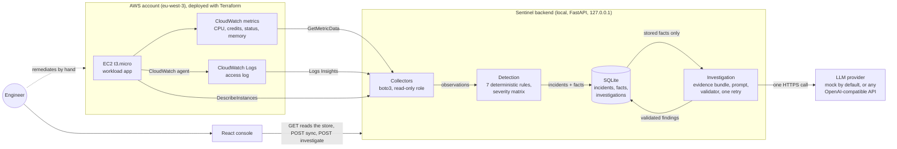

# CloudOps Sentinel

[](https://github.com/777Youness/cloudops-sentinel/actions/workflows/ci.yml)

**Evidence-based incident investigation for AWS workloads.**

Sentinel reads real AWS telemetry through a read-only IAM role, detects incidents with
deterministic rules, and asks an LLM, on demand, to write an investigation in which every
hypothesis must cite facts that the code collected. Severity comes from a rule matrix, never
from the model. Sentinel never changes AWS: remediation is advice, and a human decides.

> **Status: V1 complete as a portfolio release (2026-11-17).** The full chain ran once on a
> real AWS account: Terraform deployment, read-only collection, a real high-severity 5xx
> incident, an LLM investigation, and a full teardown. See [what is verified](#what-is-verified)
> and [limitations](#limitations).

## Why

During an incident, an engineer needs to know three things: what is wrong, whether the data
can be trusted, and what explains it. LLMs are good at the third and unreliable at the first
two. Sentinel splits the work: **code produces facts, rules decide severity, the LLM only
interprets**, and a validator rejects any reply that cites a fact that does not exist,
claims a severity, or contains a command.

## Architecture



Three layers, each with its own guarantee:

| Layer | Produced by | Guarantee |
|---|---|---|
| Observations | Collectors (simulator or AWS) | Missing data stays missing, never becomes 0 |
| Facts and incidents | Pure detection rules | Reproducible: same input, same incident and severity |
| Investigation | LLM, then a validator | Every hypothesis cites existing facts; saved apart from the incident |

Only `POST /api/v1/sync` calls AWS and only `POST /api/v1/incidents/{id}/investigation`
calls an LLM; every `GET` reads the store. Import rules between layers (for example, boto3
only in `collectors/aws/`) are enforced by a test. Details: [docs/architecture.md](docs/architecture.md).

## Capabilities

- **Telemetry**: discovers EC2 instances tagged `cloudops-sentinel:monitor=true`; reads CPU,
  CPU credits, status checks and memory with one batched `GetMetricData` call; derives request
  rate, 5xx rate and p95 latency from the access log with two bounded Logs Insights queries.
  Partial failures are reported per collector, never shown as healthy data.
- **Detection**: 7 rules (CPU saturation, CPU credits, memory, status check, 5xx, latency,
  user impact) with documented thresholds ([docs/detection-rules.md](docs/detection-rules.md)).
  Facts also record what was checked and normal, and what could not be measured.
- **Incident lifecycle**: updates with new evidence, keeps its peak severity, resolves after
  10 clean minutes, reopens as a new incident.
- **Investigation**: hypotheses with confidence, next checks and conditional remediation,
  each citing fact ids. Invalid replies get one retry with the reason, then fail; they are
  never repaired. A "high" confidence that rests only on co-occurring breaches is rejected.
- **Console**: Overview, Incidents, Incident workspace (signal charts, timeline, evidence,
  investigation) and System pages, with loading, empty, error and stale states.
- **Simulated mode** (default): ten scenarios, no AWS account needed, clearly labelled.

## Technology

| Area | Stack |
|---|---|
| Backend | Python 3.12, FastAPI, Pydantic v2, boto3, httpx, SQLite (stdlib), uv, ruff, pytest |
| Frontend | React 19, TypeScript (strict), Vite, React Router, TanStack Query, Recharts, CSS Modules |
| API contract | OpenAPI exported from the backend; TypeScript types generated and checked in CI |
| Infrastructure | Terraform (AWS provider 6), VPC, EC2, IAM, CloudWatch agent, CloudWatch Logs |
| LLM | Provider-agnostic: a deterministic mock, or any OpenAI-compatible endpoint (tested with GroqCloud `openai/gpt-oss-20b`) |
| CI | GitHub Actions: lint, tests, API-contract check, typecheck, build, gitleaks secret scan |

## Security architecture

- **Read-only by construction**: Sentinel assumes a dedicated role whose policy allows only
  read actions (plus Logs Insights query control), pinned by a test
  ([infra/policies/sentinel-readonly.json](infra/policies/sentinel-readonly.json)). No backend
  code may call a mutating AWS API; an architecture test enforces where boto3 can be imported.
- **No long-lived keys**: credentials come from the standard boto3 chain through an
  assume-role profile; nothing is stored in `.env`. Account IDs are masked in API errors.
- **Least-privilege operator**: Terraform runs with a scoped operator policy that includes
  an explicit Deny; the instance role has SSM core access plus CloudWatch writes limited to
  the agent's namespace and the workload log group.
- **Small attack surface**: no SSH (access through SSM only), the app port is open to a single
  `/32`, IMDSv2 required, encrypted root volume, the API binds to `127.0.0.1`.
- **LLM boundary**: the model receives only the evidence bundle (no raw series, text clipped,
  evidence marked as data, not instructions). Its reply cannot set severity or contain
  commands, and every citation is checked against the stored facts.
- **Cost guardrails**: forbidden resource types (NAT gateway, load balancers, RDS…) are
  checked by tests; one custom metric; 3-day log retention; an auto-termination timer (not yet
  validated on AWS); a read-only leftover check after `terraform destroy` ([docs/cost.md](docs/cost.md)).

## Design trade-offs

| Decision | Why | What it costs |
|---|---|---|
| Rules detect, the LLM only interprets ([ADR 0004](docs/adr/0004-rule-based-severity.md)) | Severity must be reproducible and testable | Fixed thresholds miss unknown failure modes |
| Sentinel runs locally ([ADR 0001](docs/adr/0001-local-first-sentinel.md)) | Validate the product before paying to host it | Single user, no authentication, manual syncs |
| Polling on sync, not streaming ([ADR 0018](docs/adr/0018-aws-telemetry-collector.md)) | Bounded, predictable API cost; simple to reason about | Data is as fresh as the last sync |
| SQLite document store ([ADR 0013](docs/adr/0013-sqlite-document-store.md)) | Zero setup, transactions, easy to inspect | No concurrency at scale, no backup |
| Reject, never repair, LLM output ([ADR 0015](docs/adr/0015-investigation-provider.md)) | A repaired answer hides how wrong the model was | Some runs fail and must be re-run |
| Mock provider by default | Fully usable with no key and no network | The default investigation is template text, labelled as such |
| No UI component library ([ADR 0011](docs/adr/0011-css-modules-and-tokens.md), [ADR 0020](docs/adr/0020-light-card-dashboard-visual-language.md)) | Small bundle, every style explainable | More CSS written by hand |

All decisions: [docs/adr](docs/adr).

## The real-AWS incident demonstration

Run once by the owner on 2026-11-17 (steps in [infra/README.md, section 8](infra/README.md)):

1. **Deploy**: `terraform apply` created 19 resources in eu-west-3: VPC, a t3.micro running a
   small stdlib HTTP app, the CloudWatch agent, a log group, an alarm, and Sentinel's read-only
   role.
2. **Healthy baseline**: in an earlier deployment of the same configuration, a sync collected
   7/7 signals with all three collectors `ok` and opened no incident.
3. **Inject faults**: [scripts/demo_traffic.py](scripts/demo_traffic.py) sent about one request
   per second, every fifth one to a dev-only `/fault/500` route
   ([ADR 0019](docs/adr/0019-dev-fault-injection-for-the-5xx-demo.md)).
4. **Detect**: the next sync opened **INC-0001, severity high**: the 5xx error rate stayed at
   or above 5% for 11 minutes, with a peak of **21.1%**. The same incident also recorded a
   low CPU credit balance, while CPU utilization, memory, status checks and latency were
   recorded as normal.
5. **Investigate**: GroqCloud `openai/gpt-oss-20b` through the OpenAI-compatible provider. The
   first prompt version produced a confident but unsupported claim ("credit exhaustion caused
   throttling, leading to 5xx errors") although CPU was at 0.8%. That led to prompt
   `investigation-v2` and a validator rule: a high-confidence hypothesis cannot rest on
   co-occurring breaches alone. The v2 run reported that "no evidence links the two", kept
   competing explanations at low or medium confidence, and made every remediation
   conditional. Both runs are recorded in
   [docs/examples/](docs/examples/2026-11-17-gpt-oss-20b-INC-0001.json).
6. **Tear down**: `terraform destroy` removed all 19 resources, and the read-only
   `scripts/cost-check.sh` found no leftovers.

The real run also exposed a time-zone bug (CloudWatch timestamps arrived in local time and a
fact printed the wrong UTC hour). It was fixed with a regression test. Mocked tests had not
caught it.

## What is verified

| Capability | Evidence |
|---|---|
| Terraform deployment and full destroy (19 resources) | Run on AWS by the owner, leftover check clean |
| Read-only role assumption, 3 collectors, 7/7 signals | Run on AWS by the owner (healthy sync) |
| Real R-5XX incident from real logs, severity high | Run on AWS by the owner (INC-0001) |
| LLM investigation through an OpenAI-compatible API | Run with GroqCloud; replies recorded in `docs/examples/` |
| Detection rules, lifecycle, storage, API, validator | Automated tests (pytest), CI |
| AWS collectors, IAM policies, infrastructure guardrails | Automated tests with botocore Stubber and policy and Terraform checks; no AWS calls in CI |
| Console | Automated tests (Vitest, Testing Library); reviewed in a browser |

## Limitations

**Not validated on AWS**
- **Automatic incident resolution** (10 clean minutes) is tested locally but was not observed
  on AWS: the workload was destroyed while INC-0001 was still open.
- **The EC2 safety timer** (instance terminates itself after a set time) has never been
  observed terminating a real instance. Always run `terraform destroy`.

**Not built in V1**
- Deployment events and alarm states are not collected in AWS mode; Resources pages; Docker
  Compose; scheduled syncs; authentication. Sentinel is single-user and must stay bound to
  `127.0.0.1`.

**By nature of the approach**
- An LLM investigation ranks explanations; with metrics alone it rarely proves a cause.
  The validator checks structure and citations, not whether the wording overclaims. The
  console marks every hypothesis "Inferred", and remediation is always a human decision.
- Results vary between models and between runs; the reliability cases in
  `backend/evals/` must be re-run when the model or prompt changes.

## Run locally

Requirements: Python 3.12, [uv](https://docs.astral.sh/uv/), Node.js 22. No AWS account or API
key is needed: the default mode replays simulated scenarios and uses the mock provider.

```bash
# terminal 1: backend on 127.0.0.1:8000
cd backend
uv sync
uv run uvicorn sentinel.main:app --reload --host 127.0.0.1 --port 8000
```

```bash
# terminal 2: console on http://127.0.0.1:5173 (proxies /api to the backend)
cd frontend
npm install
npm run dev
```

Open http://127.0.0.1:5173 and click **Sync now**: eight incidents appear, labelled as
simulated data. Sync again: one incident escalates and one resolves. API documentation:
http://127.0.0.1:8000/docs.

### Optional: a real LLM

Any OpenAI-compatible Chat Completions endpoint works. Copy `backend/.env.example` to
`backend/.env` (gitignored) and set:

```bash
SENTINEL_LLM_PROVIDER=openai_compatible
SENTINEL_LLM_BASE_URL=http://localhost:11434/v1   # Ollama on this machine, no key
SENTINEL_LLM_MODEL=<model name>
# hosted example: SENTINEL_LLM_BASE_URL=https://api.groq.com/openai/v1
# SENTINEL_LLM_API_KEY=<your key>                 # never commit it
```

Restart the backend, open an incident, click **Run investigation**. Only the incident's
evidence bundle is sent; check a hosted provider's data terms first. To compare a model
on five fixed cases (at most 10 calls, dry run without `--yes`):

```bash
cd backend
uv run python -m evals.investigation_reliability --yes
```

### Optional: AWS mode

Requires your own AWS account and the Terraform workload. Setup, sign-in profiles, the
read-only role, the incident demo and the cleanup are in [infra/README.md](infra/README.md).
Expected cost: about $0.02 per running hour ([docs/cost.md](docs/cost.md)).

## Checks

```bash
cd backend && uv run ruff check . && uv run ruff format --check . && uv run pytest -q
```

```bash
cd frontend && npm run gen:api && npm run typecheck && npm run lint && npm test -- --run && npm run build
```

## Screenshots

Screenshots are not in the repository yet. To add them, save PNG files under
`docs/screenshots/` with the names below, then link them here.

| File | What to capture | How |
|---|---|---|
| `overview.png` | Overview with open incidents by severity and data trust | Simulated mode, after one **Sync now**, window 1440 px wide |
| `incidents.png` | Incidents table with severity, status and investigation columns | Incidents page, **Open** tab |
| `workspace.png` | Incident workspace: signal charts with the breach window, timeline, evidence | Open a high-severity incident, scroll to show charts and facts |
| `investigation.png` | Investigation panel: hypotheses with confidence, citations, "Human decision" tag | Run an investigation; mock output is labelled, a real model run is more telling |
| `system.png` | System page: collectors and last sync | After a sync |
| `aws-incident.png` (optional) | A real AWS incident, data origin "AWS" | Only from a real AWS run; never edit or stage it |

Before publishing a screenshot, check that it shows no account ID, instance ID, public IP
address, API key, browser profile or local file path. Simulated mode shows none of these.

## Repository

```
backend/    FastAPI app: collectors, detection, investigation, store, services, tests, evals
frontend/   React + TypeScript console
infra/      Terraform for the monitored dev workload, IAM policies
workload/   the small stdlib HTTP app deployed on EC2
scripts/    demo traffic, leftover check, policy rendering (run by a human)
docs/       architecture, domain model, API, rules, design system, cost, ADRs
CLAUDE.md   rules for AI-assisted development in this repository
```

Further reading: [docs/architecture.md](docs/architecture.md),
[docs/detection-rules.md](docs/detection-rules.md), [docs/domain-model.md](docs/domain-model.md),
[docs/api.md](docs/api.md), [docs/cost.md](docs/cost.md), and
[docs/PROJECT-MASTERY.md](docs/PROJECT-MASTERY.md) (design rationale and interview notes).

## Acknowledgements

- The principle "the deterministic tool detects, the AI interprets" was influenced by
  [TerraGuard-AI](https://github.com/vatul16/TerraGuard-AI). CloudOps Sentinel has its own
  architecture, code and interface.
- The console's visual language takes inspiration from the MIT-licensed
  [Minimal UI kit](https://github.com/minimal-ui-kit/material-kit-react); no code or assets
  were copied ([ADR 0020](docs/adr/0020-light-card-dashboard-visual-language.md)).
