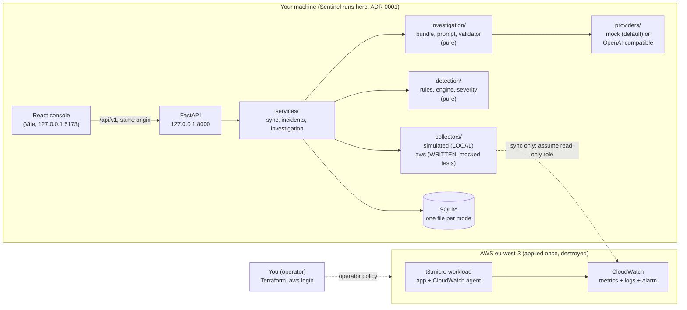
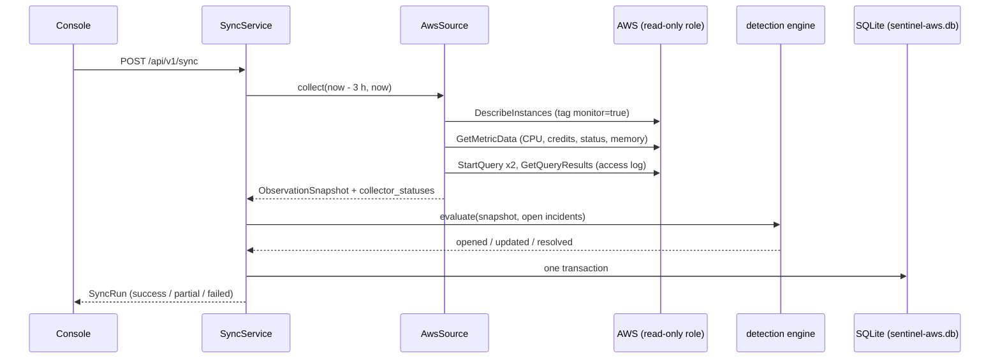

# CloudOps Sentinel: project mastery guide

A learning guide, not a diary. Its goal: you can explain, justify and defend every important
part of CloudOps Sentinel in an interview, in your own words. Update a section when a change
introduces or alters a concept, a decision or a component interaction; leave small fixes out.
Details live in the ADRs (`docs/adr/`), the code and the tests: this guide links to them.

**Status labels used everywhere below**

| Label | Meaning |
|---|---|
| LOCAL | Implemented and tested locally (and in CI) |
| WRITTEN | Implemented (possibly tested with mocked AWS) but never run against AWS |
| AWS-VALIDATED | Observed working in a real AWS account |
| PLANNED | Designed or scheduled, not implemented |

Current state (2026-11-17, V1 portfolio release), as reported by the owner. AWS-VALIDATED:
the full Terraform (19 resources) applied and destroyed to an empty state, leftover check
clean; Sentinel assumed its read-only role; all three collectors succeeded with 7/7 signals
on a healthy workload; the 5xx demo (C8) opened a real high-severity incident (peak 21.1%);
GroqCloud `openai/gpt-oss-20b` investigated it (C3). NOT observed on AWS: automatic
resolution (the workload was destroyed with the incident still open), the safety timer.

---

## A. Vision and problem

**The problem.** When a server misbehaves, an engineer collects metrics, compares them with
thresholds, looks for what changed (a deployment?), and writes down what probably happened.
Two things go wrong in practice: alerts without context or on tiny samples, and AI
summaries that sound right but invent facts.

**What Sentinel does.** A local console that reads telemetry, detects incidents with
deterministic rules, and asks an LLM, on demand, to write an investigation in which every
hypothesis must cite a fact the code produced. Humans decide and act.

**What it deliberately does not do.** It never changes AWS (read-only role, principle 4).
The LLM never creates facts or sets severity. No auto-remediation, no chat, no agents, no
hosting of Sentinel itself in V1 (ADR 0001).

**Who would use it.** An on-call engineer or a small team running a few EC2 workloads who
wants explainable incidents and an assistant that cannot hallucinate evidence.

**Pitches**
- *30 seconds:* "Sentinel is a local incident console for AWS EC2. Deterministic rules turn
  CloudWatch telemetry into facts with ids and rule-based severity. An LLM can then write an
  investigation, but every claim must cite a fact id, and a validator rejects anything
  else. Sentinel only reads AWS; humans remediate."
- *2 minutes:* add the three layers (observations, facts and incidents, investigation), the
  sync as the only collection path (cost control), the incident lifecycle with SQLite, the
  mock LLM default, and the Terraform workload with a read-only role and a safety timer.
- *5 minutes:* walk through one incident end to end (section C), then one decision you would
  defend (section D) and one limitation you know about (section D, "limits").

---

## B. Architecture

| Component | Responsibility | Status |
|---|---|---|
| `frontend/` | Overview, Incidents, Incident workspace (charts, evidence, investigation panel), System | LOCAL |
| `backend/sentinel/api/` | HTTP routes only; errors as one envelope | LOCAL |
| `services/` | Orchestration: sync (writes), reads, investigation | LOCAL |
| `collectors/simulated.py` | Replays YAML scenarios relative to "now" | LOCAL |
| `collectors/aws/` | Discovery, `GetMetricData`, Logs Insights, error translation (ADR 0018) | AWS-VALIDATED once (healthy run, owner) |
| `detection/` | Rules, lifecycle, severity matrix, health. No I/O | LOCAL |
| `investigation/` | Evidence bundle, prompt, validator; providers are the only LLM HTTP | LOCAL (real LLM run never recorded) |
| `store/sqlite.py` | JSON documents in SQLite, migrations, one transaction per sync | LOCAL |
| `infra/envs/dev/` | VPC, public subnet, t3.micro, IAM roles, log group, alarm (19 resources) | AWS-VALIDATED (applied and destroyed, owner); safety timer UNTESTED |
| `workload/app.py` | Demo HTTP app writing a JSON access log; dev-only `/fault/500` (ADR 0019) | App AWS-VALIDATED (owner); fault route LOCAL |
| `infra/policies/` | Operator policy, assume-reader policy, Sentinel read-only policy | LOCAL as files; the operator policy was used for the one apply (owner) |

**Trust boundaries**
1. *Browser ↔ API:* no authentication; the API binds to 127.0.0.1 (documented limitation).
2. *Sentinel ↔ LLM:* only the evidence bundle leaves; the reply is untrusted until validated.
3. *Sentinel ↔ AWS (WRITTEN):* the backend assumes a read-only role (explicit Deny on every
   write); only the sync calls AWS.
4. *Operator ↔ AWS:* a scoped IAM user, short-lived credentials, no access keys.
5. *Telemetry content:* log lines are data, never instructions (prompt-injection boundary).

**Boundaries are enforced by tests, not by discipline:** `tests/test_architecture.py`
(imports), `test_readonly_policy.py`, `test_operator_policy.py`, `test_infra_guardrails.py`.

---

## C. End-to-end workflows

### C1. One sync (LOCAL)
1. `POST /api/v1/sync`; a non-blocking lock rejects a second sync with 409.
2. The source collects the last 3 hours (outside any transaction, so a slow source never
   blocks readers).
3. One SQLite transaction: evaluate rules against open incidents, write opened, updated and
   resolved incidents, record the `SyncRun`. All or nothing.
4. A failing source is a 200 with `status: failed`: the HTTP status describes the call, the
   domain status describes the outcome.
Code: `services/sync.py`, `store/sqlite.py`.

### C2. Rules to incidents (LOCAL)
- A rule looks at the **trailing run** of breaching datapoints (the breach still ongoing);
  a gap breaks it; missing data is never zero.
- Guards stop false alarms: R-5XX needs at least 50 requests; R-LAT needs 30 minutes of
  baseline.
- One incident per resource; severity is the highest entry in `detection/severity.py`.
- Facts are append-only (`F1`, `F2`, ...) because investigations cite them by id.
- Resolution needs 10 clean minutes (hysteresis); missing data never resolves.
Docs: `docs/detection-rules.md`. Tests: `tests/unit/test_rule_*.py`, `test_lifecycle.py`.

### C3. Investigation (LOCAL with the mock; real Groq runs on INC-0001 with prompts v1 and v2)
1. Bundle = incident identity + facts + timeline (no raw series, text clipped to 300) +
   `evidence_scope`: what each fact kind means, and what Sentinel did not collect.
2. Prompt (v2) puts the evidence between markers declared as data, with reasoning rules.
3. Provider replies; the validator rejects (never repairs): not JSON, forbidden fields,
   unknown or missing citations, commands, long text, unsupported "high" confidence...
4. One retry with the reason; second rejection = `failed`, saved with its reason.
5. Saved separately; `outdated` when the incident's evidence hash changes.
Code: `investigation/`, `services/investigation.py`. ADR 0015.

**Citations are not proof (lesson of INC-0001, 2026-11-17).** The first real run
(`openai/gpt-oss-20b`, prompt v1) received F1 "credit balance at or below 5 (lowest 0.0)",
F2 "5xx rate 21.1%" and F3 "CPU utilization 0.8%". It answered, at **high** confidence,
"credit exhaustion caused throttling, leading to 5xx errors", and proposed scaling. Every
check passed: valid JSON, real ids. A citation proves that a fact *exists*, not that it
*supports* the sentence around it. Here, F3 even argued against it: throttling only limits
CPU demand above the baseline, and demand was near zero. The two breaches only co-occurred.
What changed, and what kind of guarantee each change gives:
- *Input (deterministic):* `evidence_scope` tells the model that a within_normal fact
  counts against an explanation, that a data gap is unknown, and that deployment events are
  not collected in AWS mode (no event fact does not mean no change).
- *Prompt (guidance only):* correlation is not causation, alternatives, confirm/refute
  checks, conditional and proportional remediation, a definition of each confidence level.
- *Validator (enforced, structural):* `confidence_unsupported` rejects "high" when the
  hypothesis joins breaches of two or more rules (no fact kind records a causal link), or
  rests on data gaps only. It reads ids, kinds and confidence, never wording: the same
  sentence at "medium" passes. Overclaiming *wording* cannot be checked by code.
- *Evaluation (measured by hand):* `backend/evals/investigation_reliability.py` runs cases
  A-E against the configured model. Unit tests prove the rules, not the model's reasoning.

**Severity is not confidence.** Severity is the rule matrix's judgement of *impact*
(`detection/severity.py`): a 21% 5xx rate is high whatever the cause. Confidence is the
model's judgement of *how well the evidence supports one explanation*. A high-severity
incident can, and often should, have only low or medium confidence hypotheses.

**Limits of LLM investigations.** The model sees only derived facts (no logs, traces,
process data or configuration), so it can rank explanations but rarely establish one.
It can still overclaim at "medium", or choose wording that sounds certain; the console
marks every hypothesis "Inferred", and the human decides. Results differ between models
and between runs of the same model.

### C4. Provisioning and telemetry (applied once by the owner; agent output not yet observed)
1. You sign in with `aws login`; Terraform uses a `credential_process` bridge profile.
2. Terraform creates the network, the instance role, the log group, the instance, the alarm.
3. user_data arms the safety timer **first**, installs the CloudWatch agent, starts the app.
4. The agent publishes `mem_used_percent` (one metric, `InstanceId` only) and ships the
   access log; EC2 publishes CPU, credits and status checks itself (basic monitoring).
5. Sentinel's sync reads these through the read-only role (C7).
Docs: `infra/README.md`, ADR 0016, ADR 0017.

### C5. IAM protection (tested files; operator policy used once, Sentinel role not applied)
Three identities, three policies, never mixed (ADR 0017, ADR 0018):

| Identity | Can | Cannot |
|---|---|---|
| Operator user | Build exactly this workload: t3.micro, IMDSv2, encrypted gp3, Amazon AMI | Create users, access keys, Organizations, Identity Center, EIPs, NAT, endpoints |
| Instance role | Write its own log group; publish metrics in `CWAgent` | Create log groups, anything else |
| Sentinel role (WRITTEN) | Ten read actions, region-pinned; assumed only by the user named in `sentinel_reader_arn` | Any write (explicit Deny) |

**Operator vs Sentinel.** Both start from your one sign-in, but they are different identities.
Terraform uses `sentinel-terraform` (your user: it can build and delete the workload). The
backend uses `sentinel`, which calls `sts:AssumeRole` and then works with the role's
temporary credentials, so every AWS call Sentinel makes is limited to reading telemetry. If
the backend had a bug that tried to stop an instance, IAM would deny it: the safety is in
the identity, not in the code. Your user needs one extra small policy to assume the role
(`operator-assume-sentinel.json`), kept apart from the Terraform policy.

Two mechanisms do the work: **conditions** (`ec2:InstanceType`, `iam:PassedToService`,
`kms:ViaService`, `aws:ResourceTag/Project`) let AWS itself refuse the wrong request, and an
**explicit Deny** beats any Allow attached later.

*Lesson from the policy-size fix (2026-11-08):* a customer managed policy is limited to
6,144 characters, whitespace not counted (an AWS IAM quota; AWS documents the limit, not
its reason). The operator policy rendered to 6,353. The fix shortened the `Sid`s only:
a `Sid` is an optional label that IAM does not use when evaluating a request, so renaming
it cannot change what is allowed (verified: every Effect, Action, Resource and Condition is
byte-identical; size now 5,970). The tempting alternatives were worse: widening actions to
wildcards removes restrictions; an inline user policy has an even smaller limit. If the
policy grows again, split it into two managed policies. A test now fails above 6,000.

### C6. Safety and cost controls (WRITTEN; timer UNTESTED)
- Safety timer: `systemctl poweroff` after 240 minutes; shutdown behaviour `terminate`, so
  the instance, its root volume and its public IP go away. `halt` would not work (AWS: it
  does not initiate a shutdown).
- Destroy after every session, then `scripts/cost-check.sh` (read-only; exit 2 if a check
  failed, never "clean" by accident).
- Budget must exclude credits, or it can stay silent while credits pay (`IncludeCredit`
  defaults to true).
- Verified Paris prices: about $0.018 per running hour (`docs/cost.md`).

### C7. AWS telemetry collection (AWS-VALIDATED once on a healthy workload)

1. **Polling, on demand.** Nothing is collected until you click Sync now (ADR 0003); every
   page reads SQLite. Freshness is the price; cost and failures stay in one place.
2. **Discovery** by tag `cloudops-sentinel:monitor=true`: Sentinel monitors what you
   labelled, not everything in the account.
3. **Metrics** in one batched `GetMetricData`: EC2 basic monitoring (CPU and credits every
   5 minutes, status checks at 1 minute, to be confirmed) and the agent's memory metric.
   Only complete periods are kept (a point at T covers [T, T + period)).
4. **Log signals**: two Logs Insights queries per sync turn the JSON access log into
   requests per minute, 5xx % and p95 latency per instance (the log stream is the instance
   id). A minute with no line is missing; a minute with requests and no 5xx is 0 %.
5. **Same pipeline.** The snapshot looks exactly like a simulated one, so the same rules,
   lifecycle and store produce the incident; only `data_origin` says `aws`.
6. **Failures are data about the data.** Discovery fails: the sync fails and nothing is
   evaluated. Metrics or logs fail: that collector is `failed`, its signals are missing,
   the sync is `partial`; missing data opens `data_gap` facts and never resolves an
   incident. The System page shows each collector's error code and hint.

How AWS telemetry becomes an incident, concretely: CPUUtilization at 97% for the last four
5-minute periods → `trailing_run` finds 20 minutes ≥ 90% → R-CPU-SAT triggers → the engine
opens one incident for the instance with fact `F1` (template text, window, peak), severity
`medium` from the matrix, and `data_gap` facts for memory and traffic if those were missing
(`tests/aws/test_aws_sync.py`, first test). Code: `collectors/aws/`, `services/sync.py`.
ADR 0018.

### C8. From one HTTP 500 to an incident (AWS-VALIDATED once: detection; resolution not observed)
The demo (ADR 0019, `infra/README.md` section 8) uses the real rule, unchanged:
1. **The request.** `scripts/demo_traffic.py` sends 1 request per second; every 5th goes
   to `GET /fault/500`, a fixed route that answers 500 (only when the dev workload sets
   `WORKLOAD_FAULTS_ENABLED=1`; otherwise 404).
2. **The log line.** The app writes `{"time","method","path","status":500,"duration_ms"}`
   before it answers, so every answered request is logged.
3. **CloudWatch Logs.** The agent tails the file and ships each line to
   `/cloudops-sentinel/dev/access`, stream = instance id.
4. **The signal.** At sync, Logs Insights counts requests and `status >= 500` per instance
   and per minute; `error_rate_5xx = 100 × errors / requests` = 12 / 60 = 20 %. Minutes
   without lines are missing; the newest 3 minutes are left out (in progress + ingestion).
5. **The decision.** R-5XX takes the trailing run of minutes at ≥ 2 %: it must last 5
   minutes (no gap) and contain ≥ 50 requests (here 300). Because ≥ 5 % also held for 5
   minutes, `severity.py` maps it to **high**. The engine opens one incident with an
   append-only fact ("5xx error rate at or above 5% for 6 min ... (peak 20.0%)"),
   `within_normal` / `data_gap` facts for the other signals, and stores it in one
   transaction. After 10 clean minutes of healthy traffic, it resolves.
Tested end to end with mocked AWS in `tests/aws/test_demo_5xx_incident.py`, including the
negative cases: 4 minutes is not enough, a missing minute breaks the run, and the same 20 %
on 5 requests per minute does not alert.

---

## D. Decisions and trade-offs

Each entry: problem → choice → why → alternatives → their rejection → limits → when to
switch.

**D1. Deterministic detection, AI only for interpretation (ADR 0004).**
Problem: incidents and severity must be reproducible and testable. Choice: rules and a
severity table; the LLM explains evidence it cannot change. Alternative: AI-based anomaly
detection or LLM-assigned severity, rejected because it is not reproducible or unit-testable
and is out of scope ("Never: ML anomaly models"). Limits: fixed thresholds miss unknown
failure modes and need tuning per service. Switch when you have many services with very
different baselines and the labelled history to evaluate a model.
*The demo makes this concrete:* the same 20 % error rate is high severity at 60 requests
per minute and no incident at all at 5 per minute (below the 50-request guard). That
judgement is a line of code with a test; an LLM asked "is this an incident?" could answer
differently on two runs, and nobody could test why. The LLM's job starts after the
decision: explaining the cited facts.

**D2. Local console instead of a hosted service (ADR 0001).**
Problem: credibility needs real AWS data; hosting needs compute, TLS and auth first. Choice:
run Sentinel locally, deploy only the monitored workload. Alternatives: EC2 next to the
workload (fails with what it monitors), ECS Fargate behind an ALB (always-on cost, auth
before the product is proven). Limits: no auth, one user, no 24/7 monitoring. Switch after
V3, when the core is validated and authentication is designed.

**D3. SQLite documents instead of RDS or an ORM (ADR 0013).**
Problem: incidents must survive restarts. Choice: stdlib `sqlite3`, JSON bodies, a few
indexed columns, `PRAGMA user_version` migrations, one file per mode. Alternatives: RDS
(forbidden, billed hourly, a network dependency), normalised tables (joins for no query),
an ORM (hides the SQL, not allowed). Limits: one connection serialises requests; model
changes need migrations. Switch to PostgreSQL/RDS for multiple users or a hosted Sentinel.

**D4. EC2 workload instead of Lambda or ECS Fargate.**
Problem: the rules target EC2 signals: CPU credits (T-family), status checks, memory from
an agent. Choice: one t3.micro. Alternatives: Lambda (no CPU credits, no status checks, no
host memory: different signals entirely), Fargate (forbidden, different metrics). Limits:
one instance, one AZ, manual lifecycle. Switch when monitoring serverless or containers
becomes a goal, with new rules.

**D5. CloudWatch instead of Prometheus.**
Problem: get metrics and logs without running more infrastructure. Choice: native EC2
metrics, the CloudWatch agent for memory and logs. Alternative: Prometheus + exporters,
rejected because it needs its own server, storage and access path. Limits: per-metric and
per-query costs, AWS-only. Switch for multi-cloud or Kubernetes, or very high cardinality.

**D6. IAM user with `aws login` instead of access keys or Identity Center (ADR 0017).**
Problem: Terraform needs credentials; long-lived keys leak; Identity Center would require
Organizations, which would expire the account's credits. Choice: an IAM user with MFA and no
keys, short-lived credentials via `aws login`, a `credential_process` bridge for Terraform.
Limits: bridge needed until the provider supports the credential type natively (unverified);
one human user. Switch to Identity Center and roles for a team or a multi-account setup.

**D7. Terraform instead of CloudFormation.**
Problem: describe and recreate the workload reproducibly. Choice: Terraform with a pinned
provider and local state (ADR 0016). Alternative: CloudFormation, which keeps state inside
AWS (nothing to lose locally) and needs no extra tool; rejected mainly for plan readability
and portability of the skill, which is a portfolio choice, not a technical necessity. Limits:
the local state file is a single point of failure. Switch to an S3 backend with locking
(`use_lockfile`) for CI or a second operator; CloudFormation is a fair choice for AWS-only teams.

**D8. Pull with boto3 from CloudWatch, on sync (ADR 0018).**
Problem: get real telemetry into the existing pipeline without new infrastructure. Choice:
the official SDK (boto3), pulling from CloudWatch Metrics and Logs only when a sync runs.
Alternatives: the AWS CLI from Python (stringly typed, harder to test), push via alarms →
SNS → webhook (needs a public endpoint and SNS, out of scope), Prometheus exporters (an
extra server), a scheduler (auto-sync is V4). Limits: data is as fresh as the last click;
each sync costs a little (`GetMetricData`, Logs Insights). Switch to scheduled collection
or a push pipeline when someone must be paged at night.

**D9. Logs Insights for request rate, 5xx and latency.**
Problem: the app's traffic signals are not EC2 metrics. Choice: aggregate the JSON access log
at query time. Alternatives: metric filters or the Embedded Metric Format (each produces
custom metrics, billed per metric, against the 5-metric budget), an ALB's metrics (an ALB is
forbidden). Limits: per-GB scanning cost, query latency, and a dependency on field names
(`@logStream`, `bin(1m)`) still to verify on AWS. Switch to EMF metrics when traffic and
query volume make scanning more expensive than a few custom metrics.

**D10. A role assumed by the backend instead of reusing the operator profile.**
Problem: the backend needs AWS access, and the operator's identity can delete
infrastructure. Choice: `cloudops-sentinel-dev-readonly`, trusted by one named principal,
assumed through the `sentinel` profile. Alternatives: the operator profile (far too
powerful), a dedicated IAM user with access keys (a long-lived secret on disk), trusting the
account root (any principal allowed to call `sts:AssumeRole` could use it). Limits: the
backend still depends on your sign-in being valid (12 hours at most). Switch to an instance
or task role if Sentinel is ever hosted on AWS (no human credentials at all).

**D11. A dev-only HTTP fault route instead of lowering thresholds or SSM scripts (ADR 0019).**
Problem: show a real incident cheaply and repeatably. Choice: a fixed `/fault/500` route,
off unless the dev workload enables it, plus controlled traffic. Alternatives: lower the
thresholds (proves nothing), SSM scripts (more permissions and moving parts for the same
500s), stopping the app (produces missing data, which correctly never becomes an error
rate). Limits: it demonstrates one rule; a fault route is code that must never ship to a
real service. Switch to SSM-run chaos scripts or AWS Fault Injection Service for CPU,
memory or status-check incidents.

---

## E. Concepts to master (as they appear here)

- **Least privilege with conditions** (`infra/policies/`): restrict not only actions but the
  *shape* of a request (instance type, encryption, owner, tag).
- **Explicit Deny wins** in IAM evaluation; default is deny.
- **`iam:PassRole`**: handing a role to a service is a permission of its own.
- **CloudWatch metric identity**: namespace + name + dimensions; a new dimension is a new
  billed metric (`templates/cloudwatch-agent.json.tftpl`).
- **Datapoint periods**: a point at T covers [T, T + period); the running period is
  incomplete (`collectors/simulated.py`, the fix in `50b5ed7`).
- **Hysteresis and append-only facts** (`detection/engine.py`).
- **Transactions and atomicity** (`store/sqlite.py`).
- **Grounding and reject-don't-repair** (`investigation/validator.py`).
- **Grounding is not causation**: a cited fact exists; whether it supports the claim is
  a separate question (C3, `confidence_unsupported`).
- **Time zones at boundaries**: botocore returns CloudWatch timestamps in the machine's
  local zone; the collector converts to UTC, or a fact says "13:10 UTC" for 12:10 UTC
  (`collectors/aws/metrics.py`, `detection/statements.py:hhmm`).
- **Fail-safe ordering**: arm the timer before anything can fail (`user_data.sh.tftpl`).
- **Tests that prove themselves**: mutation testing of policies and guardrails.
- **Assume-role chains**: `role_arn` + `source_profile`; after `sts:AssumeRole` the caller is
  the role (`aws sts get-caller-identity --profile sentinel`).
- **Partial failure**: report per part (`collector_statuses`), degrade honestly, never turn
  "could not read" into "looks fine" (`collectors/aws/source.py`).
- **Testing AWS code without AWS**: botocore `Stubber` refuses unexpected calls; unsigned
  clients never look for credentials (`tests/aws/conftest.py`).

---

## F. Interview preparation

**Q: Why can't the LLM invent facts in your system?**
Answer by mechanism: facts come only from code with ids; the model sees only those facts;
the strict schema has no severity field; the validator rejects unknown citations and
commands; one retry, never repaired.
*Follow-ups:* What if the model cites a real fact for a wrong conclusion? (Citations prove
grounding, not correctness: the human judges; confidence is shown as text.) What if log text
contains instructions? (Data markers, clipping, and validation whatever the model writes.)

**Q: Your model cited real facts and still gave a wrong root cause. How do you handle it?**
Citations prove grounding, not inference. I separated what code can enforce (structure:
"high" confidence cannot join co-occurring breaches or rest on gaps) from what only the
prompt can ask (wording, alternatives) and from what must be measured (a manual eval on
fixed cases). *Follow-up:* why not a phrase filter on "caused"? It breaks on paraphrase and
blocks legitimate diagnoses; the check reads citations and confidence instead.

**Q: What happens if a component fails?**
LLM down: everything except the investigation panel works (principle 7). AWS unreachable:
the sync returns `status: failed`, old data stays on screen with a stale notice. SQLite file
lost: the history and saved investigations are gone; the next sync opens new incidents only
for what is still breaching (limitation: no backup in V1).
*Follow-up:* the Terraform state file lost? Find resources by tag with `cost-check.sh`,
delete or `terraform import` them; never re-apply blindly.

**Q: What are the security risks?**
No authentication (mitigated only by binding to 127.0.0.1); the public IPv4 of the workload
(mitigated by an ingress rule for one /32 and no SSH); LLM data egress (mitigated by the
bundle and the Ollama option); operator privilege (scoped policy, explicit Deny, no keys).
*Follow-up:* what would you change for production? Authentication, private subnets with
endpoints or NAT if budget allows, remote state, CI-driven plans, Identity Center.

**Q: How would you scale it?**
Today it is single-user by design. To scale: a hosted API with auth, PostgreSQL instead of
SQLite, scheduled syncs (EventBridge, V4), collectors per account via assumed roles, and
batching `GetMetricData` to control cost.

**Q: How do you keep costs down?**
Collection only on sync with a bounded window; one custom metric; 3-day log retention;
t3.micro; no NAT, EIP or load balancer; destroy after each session; a read-only leftover
check; a budget that excludes credits. Verified Paris prices give about $0.018 per hour.

**Q: Your IAM policy hit a size limit. What did you do, and why that way?**
It rendered to 6,353 characters against AWS's 6,144 limit for a managed policy. I shortened
only the `Sid`s, because IAM ignores them when evaluating requests, then proved every other
field was identical, and added a test that fails above 6,000. I did not widen actions to
wildcards to save space: that trades a size problem for a security problem.
*Follow-up:* and if it still did not fit? Split it into two managed policies.

**Q: Walk me through how real AWS data becomes an incident in your system.**
Click Sync → the backend assumes the read-only role → finds tagged instances → one
`GetMetricData` and two bounded Logs Insights queries → a snapshot identical in shape to the
simulator's → the same rules (trailing runs, guards, severity matrix) → one SQLite
transaction. Be precise about status: this path is tested with mocked AWS responses; it has
not yet run against the real account.
*Follow-ups:* Why not stream metrics? (One user, manual review, cost in one place; push needs
public endpoints.) What if CloudWatch throttles you? (botocore standard retries, then the
collector is `failed`, the sync `partial`, data gaps instead of fake health.) What if the
agent stops shipping logs? (The traffic signals go missing, R-5XX and R-LAT report
`insufficient_data`; nothing resolves.)

**Q: Why does Sentinel use a different identity from Terraform?**
Least privilege per job. Terraform must create and delete; Sentinel must only read. With one
shared identity, any backend bug would have infrastructure-changing power. With the role,
IAM itself refuses writes, and the policy is pinned by a test that also checks the code
calls only approved actions.
*Follow-up:* the role is assumed with your credentials, so is it really separate? (The
session has only the role's permissions; your user's do not carry over. The trust policy
names one principal; the assume permission is a separate one-action policy.)

**Q: How would this collection design scale to 100 instances or several accounts?**
`GetMetricData` takes up to 500 queries per call, so 100 instances × 4 metrics is one call;
Logs Insights already groups by log stream. Across accounts: one read-only role per account
(cross-account trust), collection in parallel, scheduled syncs. Current limits: one SQLite
connection and a manual sync.

**Q: How do you know your incident demo is not rigged?**
The thresholds are the production ones and a test pins the demo script to them; the demo
only creates the condition the rule describes (≥ 5 % errors for 5 minutes on enough
traffic). The negative tests matter as much: too short, a gap, or too little traffic must
not alert. The fault itself is a real HTTP 500 that travels the real log pipeline.
*Follow-ups:* Isn't a fault endpoint a security risk? (Fixed response, no input, no
command, off by default, dev-only by Terraform validation, reachable only from one /32.)
Why sync at minute 9 and not 5? (5 complete minutes + the running minute + 2 minutes of
ingestion delay.) What if it stays medium, not high? (≥ 5 % did not last 5 minutes.)

**Q: Why does the incident not resolve as soon as the errors stop?**
Two reasons, both deliberate. Resolution needs 10 clean minutes (hysteresis against
flapping). And clean means data present and below 2 %: if traffic simply stops, the minutes
are missing, and missing data never resolves an incident. That is why the demo has a
`healthy` phase.

**Q: What did you personally learn?**
Answer honestly and specifically, for example: that a browser review found bugs the unit
tests encoded as correct (the future timestamp), that enforcement beats convention (import
and policy tests), and that "documented by AWS" is not "observed": the safety timer is still
UNTESTED. Do not claim AWS experience the project has not produced yet.
