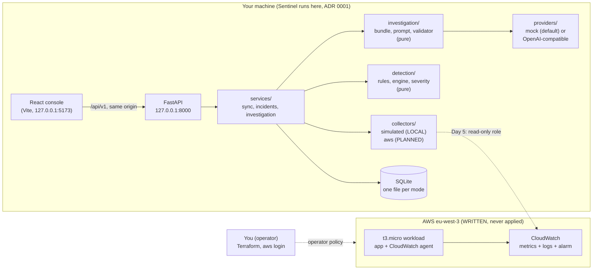

# CloudOps Sentinel: project mastery guide

A learning guide, not a diary. Its goal: you can explain, justify and defend every important
part of CloudOps Sentinel in an interview, in your own words. Update a section when a change
introduces or alters a concept, a decision or a component interaction; leave small fixes out.
Details live in the ADRs (`docs/adr/`), the code and the tests: this guide links to them.

**Status labels used everywhere below**

| Label | Meaning |
|---|---|
| LOCAL | Implemented and tested locally (and in CI) |
| WRITTEN | Implemented but never deployed or run against AWS |
| AWS-VALIDATED | Observed working in a real AWS account |
| PLANNED | Designed or scheduled, not implemented |

Current state (2026-11-08): nothing is AWS-VALIDATED yet. No AWS resource has ever existed.

---

## A. Vision and problem

**The problem.** When a server misbehaves, an engineer collects metrics, compares them with
thresholds, looks for what changed (a deployment?), and writes down what probably happened.
Two things go wrong in practice: alerts without context or on tiny samples, and AI
summaries that sound right but invent facts.

**What Sentinel does.** A local console that reads telemetry, detects incidents with
deterministic rules, and asks an LLM, on demand, to write an investigation in which every
hypothesis must cite a fact the code produced. Humans decide and act.

**What it deliberately does not do.** It never changes AWS (read-only role, principle 4).
The LLM never creates facts or sets severity. No auto-remediation, no chat, no agents, no
hosting of Sentinel itself in V1 (ADR 0001).

**Who would use it.** An on-call engineer or a small team running a few EC2 workloads who
wants explainable incidents and an assistant that cannot hallucinate evidence.

**Pitches**
- *30 seconds:* "Sentinel is a local incident console for AWS EC2. Deterministic rules turn
  CloudWatch telemetry into facts with ids and rule-based severity. An LLM can then write an
  investigation, but every claim must cite a fact id, and a validator rejects anything
  else. Sentinel only reads AWS; humans remediate."
- *2 minutes:* add the three layers (observations, facts and incidents, investigation), the
  sync as the only collection path (cost control), the incident lifecycle with SQLite, the
  mock LLM default, and the Terraform workload with a read-only role and a safety timer.
- *5 minutes:* walk through one incident end to end (section C), then one decision you would
  defend (section D) and one limitation you know about (section D, "limits").

---

## B. Architecture

| Component | Responsibility | Status |
|---|---|---|
| `frontend/` | Overview, Incidents, Incident workspace (charts, evidence, investigation panel), System | LOCAL |
| `backend/sentinel/api/` | HTTP routes only; errors as one envelope | LOCAL |
| `services/` | Orchestration: sync (writes), reads, investigation | LOCAL |
| `collectors/simulated.py` | Replays YAML scenarios relative to "now" | LOCAL |
| `collectors/aws/` | boto3 collectors through the read-only role | PLANNED (Day 5) |
| `detection/` | Rules, lifecycle, severity matrix, health. No I/O | LOCAL |
| `investigation/` | Evidence bundle, prompt, validator; providers are the only LLM HTTP | LOCAL (real LLM run never recorded) |
| `store/sqlite.py` | JSON documents in SQLite, migrations, one transaction per sync | LOCAL |
| `infra/envs/dev/` | VPC, public subnet, t3.micro, IAM role, log group, alarm (17 resources) | WRITTEN |
| `workload/app.py` | Demo HTTP app writing a JSON access log | LOCAL (never run on EC2) |
| `infra/policies/` | Operator policy, Sentinel read-only policy | LOCAL as files, never attached |

**Trust boundaries**
1. *Browser ↔ API:* no authentication; the API binds to 127.0.0.1 (documented limitation).
2. *Sentinel ↔ LLM:* only the evidence bundle leaves; the reply is untrusted until validated.
3. *Sentinel ↔ AWS (PLANNED):* a read-only role with an explicit Deny on every write.
4. *Operator ↔ AWS:* a scoped IAM user, short-lived credentials, no access keys.
5. *Telemetry content:* log lines are data, never instructions (prompt-injection boundary).

**Boundaries are enforced by tests, not by discipline:** `tests/test_architecture.py`
(imports), `test_readonly_policy.py`, `test_operator_policy.py`, `test_infra_guardrails.py`.

---

## C. End-to-end workflows

### C1. One sync (LOCAL)
1. `POST /api/v1/sync`; a non-blocking lock rejects a second sync with 409.
2. The source collects the last 3 hours (outside any transaction, so a slow source never
   blocks readers).
3. One SQLite transaction: evaluate rules against open incidents, write opened, updated and
   resolved incidents, record the `SyncRun`. All or nothing.
4. A failing source is a 200 with `status: failed`: the HTTP status describes the call, the
   domain status describes the outcome.
Code: `services/sync.py`, `store/sqlite.py`.

### C2. Rules to incidents (LOCAL)
- A rule looks at the **trailing run** of breaching datapoints (the breach still ongoing);
  a gap breaks it; missing data is never zero.
- Guards stop false alarms: R-5XX needs at least 50 requests; R-LAT needs 30 minutes of
  baseline.
- One incident per resource; severity is the highest entry in `detection/severity.py`.
- Facts are append-only (`F1`, `F2`, ...) because investigations cite them by id.
- Resolution needs 10 clean minutes (hysteresis); missing data never resolves.
Docs: `docs/detection-rules.md`. Tests: `tests/unit/test_rule_*.py`, `test_lifecycle.py`.

### C3. Investigation (LOCAL with the mock; real provider never run)
1. Bundle = incident identity + facts + timeline (no raw series, text clipped to 300).
2. Prompt puts the evidence between markers declared as data.
3. Provider replies; the validator rejects (never repairs): not JSON, forbidden fields,
   unknown or missing citations, commands, long text...
4. One retry with the reason; second rejection = `failed`, saved with its reason.
5. Saved separately; `outdated` when the incident's evidence hash changes.
Code: `investigation/`, `services/investigation.py`. ADR 0015.

### C4. Provisioning and telemetry (WRITTEN, never applied)
1. You sign in with `aws login`; Terraform uses a `credential_process` bridge profile.
2. Terraform creates the network, the instance role, the log group, the instance, the alarm.
3. user_data arms the safety timer **first**, installs the CloudWatch agent, starts the app.
4. The agent publishes `mem_used_percent` (one metric, `InstanceId` only) and ships the
   access log; EC2 publishes CPU, credits and status checks itself (basic monitoring).
5. Day 5 (PLANNED): Sentinel's sync reads these through the read-only role.
Docs: `infra/README.md`, ADR 0016, ADR 0017.

### C5. IAM protection (LOCAL as tested files; never attached in AWS)
Three identities, three policies, never mixed (ADR 0017):

| Identity | Can | Cannot |
|---|---|---|
| Operator user | Build exactly this workload: t3.micro, IMDSv2, encrypted gp3, Amazon AMI | Create users, access keys, Organizations, Identity Center, EIPs, NAT, endpoints |
| Instance role | Write its own log group; publish metrics in `CWAgent` | Create log groups, anything else |
| Sentinel role (PLANNED) | Nine read actions, region-pinned | Any write (explicit Deny) |

Two mechanisms do the work: **conditions** (`ec2:InstanceType`, `iam:PassedToService`,
`kms:ViaService`, `aws:ResourceTag/Project`) let AWS itself refuse the wrong request, and an
**explicit Deny** beats any Allow attached later.

*Lesson from the policy-size fix (2026-11-08):* a customer managed policy is limited to
6,144 characters, whitespace not counted (an AWS IAM quota; AWS documents the limit, not
its reason). The operator policy rendered to 6,353. The fix shortened the `Sid`s only:
a `Sid` is an optional label that IAM does not use when evaluating a request, so renaming
it cannot change what is allowed (verified: every Effect, Action, Resource and Condition is
byte-identical; size now 5,970). The tempting alternatives were worse: widening actions to
wildcards removes restrictions; an inline user policy has an even smaller limit. If the
policy grows again, split it into two managed policies. A test now fails above 6,000.

### C6. Safety and cost controls (WRITTEN; timer UNTESTED)
- Safety timer: `systemctl poweroff` after 240 minutes; shutdown behaviour `terminate`, so
  the instance, its root volume and its public IP go away. `halt` would not work (AWS: it
  does not initiate a shutdown).
- Destroy after every session, then `scripts/cost-check.sh` (read-only; exit 2 if a check
  failed, never "clean" by accident).
- Budget must exclude credits, or it can stay silent while credits pay (`IncludeCredit`
  defaults to true).
- Verified Paris prices: about $0.018 per running hour (`docs/cost.md`).

---

## D. Decisions and trade-offs

Each entry: problem → choice → why → alternatives → their rejection → limits → when to
switch.

**D1. Deterministic detection, AI only for interpretation (ADR 0004).**
Problem: incidents and severity must be reproducible and testable. Choice: rules and a
severity table; the LLM explains evidence it cannot change. Alternative: AI-based anomaly
detection or LLM-assigned severity, rejected because it is not reproducible or unit-testable
and is out of scope ("Never: ML anomaly models"). Limits: fixed thresholds miss unknown
failure modes and need tuning per service. Switch when you have many services with very
different baselines and the labelled history to evaluate a model.

**D2. Local console instead of a hosted service (ADR 0001).**
Problem: credibility needs real AWS data; hosting needs compute, TLS and auth first. Choice:
run Sentinel locally, deploy only the monitored workload. Alternatives: EC2 next to the
workload (fails with what it monitors), ECS Fargate behind an ALB (always-on cost, auth
before the product is proven). Limits: no auth, one user, no 24/7 monitoring. Switch after
V3, when the core is validated and authentication is designed.

**D3. SQLite documents instead of RDS or an ORM (ADR 0013).**
Problem: incidents must survive restarts. Choice: stdlib `sqlite3`, JSON bodies, a few
indexed columns, `PRAGMA user_version` migrations, one file per mode. Alternatives: RDS
(forbidden, billed hourly, a network dependency), normalised tables (joins for no query),
an ORM (hides the SQL, not allowed). Limits: one connection serialises requests; model
changes need migrations. Switch to PostgreSQL/RDS for multiple users or a hosted Sentinel.

**D4. EC2 workload instead of Lambda or ECS Fargate.**
Problem: the rules target EC2 signals: CPU credits (T-family), status checks, memory from
an agent. Choice: one t3.micro. Alternatives: Lambda (no CPU credits, no status checks, no
host memory: different signals entirely), Fargate (forbidden, different metrics). Limits:
one instance, one AZ, manual lifecycle. Switch when monitoring serverless or containers
becomes a goal, with new rules.

**D5. CloudWatch instead of Prometheus.**
Problem: get metrics and logs without running more infrastructure. Choice: native EC2
metrics, the CloudWatch agent for memory and logs. Alternative: Prometheus + exporters,
rejected because it needs its own server, storage and access path. Limits: per-metric and
per-query costs, AWS-only. Switch for multi-cloud or Kubernetes, or very high cardinality.

**D6. IAM user with `aws login` instead of access keys or Identity Center (ADR 0017).**
Problem: Terraform needs credentials; long-lived keys leak; Identity Center would require
Organizations, which would expire the account's credits. Choice: an IAM user with MFA and no
keys, short-lived credentials via `aws login`, a `credential_process` bridge for Terraform.
Limits: bridge needed until the provider supports the credential type natively (unverified);
one human user. Switch to Identity Center and roles for a team or a multi-account setup.

**D7. Terraform instead of CloudFormation.**
Problem: describe and recreate the workload reproducibly. Choice: Terraform with a pinned
provider and local state (ADR 0016). Alternative: CloudFormation, which keeps state inside
AWS (nothing to lose locally) and needs no extra tool; rejected mainly for plan readability
and portability of the skill, which is a portfolio choice, not a technical necessity. Limits:
the local state file is a single point of failure. Switch to an S3 backend with locking
(`use_lockfile`) for CI or a second operator; CloudFormation is a fair choice for AWS-only teams.

---

## E. Concepts to master (as they appear here)

- **Least privilege with conditions** (`infra/policies/`): restrict not only actions but the
  *shape* of a request (instance type, encryption, owner, tag).
- **Explicit Deny wins** in IAM evaluation; default is deny.
- **`iam:PassRole`**: handing a role to a service is a permission of its own.
- **CloudWatch metric identity**: namespace + name + dimensions; a new dimension is a new
  billed metric (`templates/cloudwatch-agent.json.tftpl`).
- **Datapoint periods**: a point at T covers [T, T + period); the running period is
  incomplete (`collectors/simulated.py`, the fix in `50b5ed7`).
- **Hysteresis and append-only facts** (`detection/engine.py`).
- **Transactions and atomicity** (`store/sqlite.py`).
- **Grounding and reject-don't-repair** (`investigation/validator.py`).
- **Fail-safe ordering**: arm the timer before anything can fail (`user_data.sh.tftpl`).
- **Tests that prove themselves**: mutation testing of policies and guardrails.

---

## F. Interview preparation

**Q: Why can't the LLM invent facts in your system?**
Answer by mechanism: facts come only from code with ids; the model sees only those facts;
the strict schema has no severity field; the validator rejects unknown citations and
commands; one retry, never repaired.
*Follow-ups:* What if the model cites a real fact for a wrong conclusion? (Citations prove
grounding, not correctness: the human judges; confidence is shown as text.) What if log text
contains instructions? (Data markers, clipping, and validation whatever the model writes.)

**Q: What happens if a component fails?**
LLM down: everything except the investigation panel works (principle 7). AWS unreachable:
the sync returns `status: failed`, old data stays on screen with a stale notice. SQLite file
lost: the history and saved investigations are gone; the next sync opens new incidents only
for what is still breaching (limitation: no backup in V1).
*Follow-up:* the Terraform state file lost? Find resources by tag with `cost-check.sh`,
delete or `terraform import` them; never re-apply blindly.

**Q: What are the security risks?**
No authentication (mitigated only by binding to 127.0.0.1); the public IPv4 of the workload
(mitigated by an ingress rule for one /32 and no SSH); LLM data egress (mitigated by the
bundle and the Ollama option); operator privilege (scoped policy, explicit Deny, no keys).
*Follow-up:* what would you change for production? Authentication, private subnets with
endpoints or NAT if budget allows, remote state, CI-driven plans, Identity Center.

**Q: How would you scale it?**
Today it is single-user by design. To scale: a hosted API with auth, PostgreSQL instead of
SQLite, scheduled syncs (EventBridge, V4), collectors per account via assumed roles, and
batching `GetMetricData` to control cost.

**Q: How do you keep costs down?**
Collection only on sync with a bounded window; one custom metric; 3-day log retention;
t3.micro; no NAT, EIP or load balancer; destroy after each session; a read-only leftover
check; a budget that excludes credits. Verified Paris prices give about $0.018 per hour.

**Q: Your IAM policy hit a size limit. What did you do, and why that way?**
It rendered to 6,353 characters against AWS's 6,144 limit for a managed policy. I shortened
only the `Sid`s, because IAM ignores them when evaluating requests, then proved every other
field was identical, and added a test that fails above 6,000. I did not widen actions to
wildcards to save space: that trades a size problem for a security problem.
*Follow-up:* and if it still did not fit? Split it into two managed policies.

**Q: What did you personally learn?**
Answer honestly and specifically, for example: that a browser review found bugs the unit
tests encoded as correct (the future timestamp), that enforcement beats convention (import
and policy tests), and that "documented by AWS" is not "observed": the safety timer is still
UNTESTED. Do not claim AWS experience the project has not produced yet.
